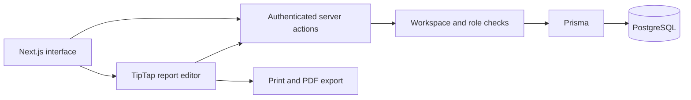
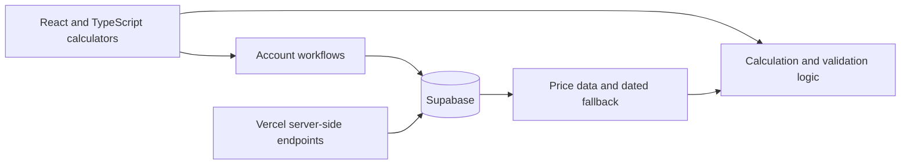

# Business software — technical case studies

## OpsFlow

[Interactive sample workspace](https://jodiabrahamsportfolio.vercel.app/projects/opsflow/demo.html)

The full application was designed around protected multi-tenant business workflows. The public demo is a separate browser-only illustration and does not prove live authorization or persistence.

The public sample uses an isolated in-memory dataset, status filters, derived task counts, report notes and browser printing. It sends no live database writes. Full application features include organization-scoped projects, tasks, reports and role-based permissions. Authentication, database health, migrations and authenticated regression checks remain separate release gates.

## FuelWise SA

[Public website](https://fuelwisesa.co.za/)

Fuel estimates combine distance, vehicle consumption and price per litre. Price provenance and regional distinctions help users interpret estimates. Account workflows and automated publishing are distinct from the public calculation tools; their production status must be validated independently. No private source or configuration is published here.

## Engineering approach

- Keep access controls server-side; never treat hidden UI controls as authorization.
- Validate inputs and distinguish verified data from estimates.
- Use regression tests, code reviews and deployment checks before release.
- Document limitations rather than claiming unverified production capabilities.
